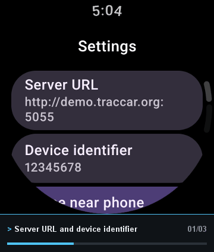
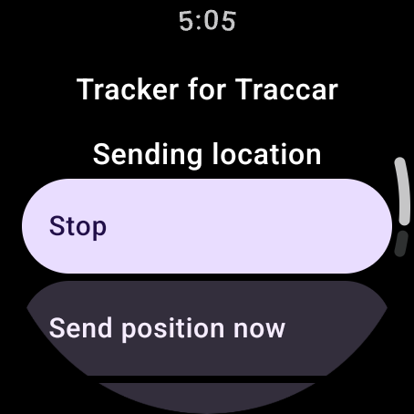
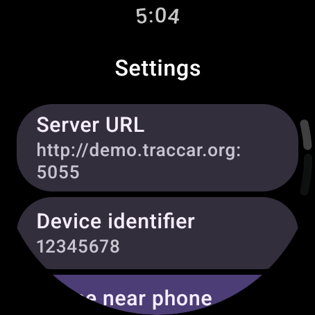
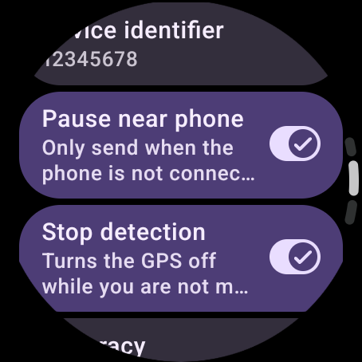

<div align="center">

# Wear OS Client for Traccar

### Your watch's location on your own Traccar server, without draining its battery.

A standalone Wear OS app that sends your smartwatch's position to your [Traccar](https://www.traccar.org) server.<br>
Built on the **official Traccar Client SDK**, and it goes silent while your phone is with you.

[](#requirements)
[](https://github.com/traccar/traccar-client-sdk)
[](LICENSE)
[](#features)
[](https://github.com/Eduzyrtin/TraccarWearClient/releases/latest)



<table>
  <tr>
    <td align="center"><br><sub>Sending your location</sub></td>
    <td align="center"><br><sub>Server and identifier</sub></td>
    <td align="center"><br><sub>Pause near phone and stop detection</sub></td>
  </tr>
</table>

**[Get it on Google Play](https://play.google.com/store/apps/details?id=com.sanabria.traccarwearosclient)** · **[Download the APK](https://github.com/Eduzyrtin/TraccarWearClient/releases/latest)** · [Who is it for?](#who-is-this-app-for) · [Getting started](#getting-started) · [Pause near phone](#pause-near-phone) · [Battery](#battery) · [FAQ](#faq)

> ### ⚠️ Who is this app for?
> **Only for watches with their own internet connection** (LTE, 5G or similar) **and an active mobile data plan**, used by people who sometimes go out **without their phone**: a walk, a run, a ride, with the watch as the only device on you.
>
> **It is not for you if** your watch only works connected to your phone, or if you always carry your phone: use the official **Traccar Client** on the phone instead. [More details](#who-is-this-app-for).

> **Free, on Google Play and GitHub.** Wear OS Client for Traccar is completely free. Install it from **[Google Play](https://play.google.com/store/apps/details?id=com.sanabria.traccarwearosclient)** for automatic updates, or download the APK from **[GitHub Releases](https://github.com/Eduzyrtin/TraccarWearClient/releases/latest)**. Same app either way.

</div>

---

## Who is this app for?

This app exists for one situation: **you leave the house with only your watch**, and you still want your Traccar server to know where you are.

**It is for you if:**
- You have a smartwatch with **its own connectivity** (LTE, 5G or similar) and a **data plan** (eSIM or SIM) active on it.
- There are times when the watch is the **only device you carry**: walks, runs, bike rides, errands.
- You self-host (or use) a Traccar server and want those outings on your map.

**It is not for you if:**
- Your watch has **no mobile connection** and relies on your phone to get online. Away from the phone it cannot send anything (positions would only be queued until it finds Wi-Fi).
- You **always carry your phone**: the official Traccar Client on the phone does the same job, with a better GPS and battery. This app is silent while the phone is with you, so it would add nothing.

Wi-Fi-only watches can work while they are connected to a known Wi-Fi network, but that is not what the app is designed for.

## Why this exists

If you walk or run with only your LTE watch, no phone, you still want your Traccar server to know where you
are. The official Traccar Client is a phone app and does not run on Wear OS. This app does the same job on the
watch, and adds one thing the phone app cannot: **while your watch is connected to your phone over Bluetooth it
stays quiet, and only when you leave the phone behind does it start reporting on its own**.

It is **not a fork**. The official apps are written in Flutter, so instead this is a native Wear OS app on top of
the official [Traccar Client SDK](https://github.com/traccar/traccar-client-sdk) (`org.traccar:traccar-client-sdk`),
the same tracking engine the official app uses. To pick up upstream improvements, bump `traccarSdk` in
`gradle/libs.versions.toml`.

This is an independent project and is not affiliated with or endorsed by Traccar.

## Features

### 📍 Reliable background tracking
- The official SDK does the work: accuracy, minimum distance, interval, **offline buffering** (positions are queued and sent when there is a connection) and **stop detection**.
- A random 8-digit device identifier is generated on first launch, like the official app.
- A **Send position now** button for a manual report.

### 📵 Pause near phone
- With the paired phone connected over Bluetooth, the watch **stays silent and the GPS is off**. Walk away without the phone and it starts sending by itself.
- Ideal for LTE watches: no duplicate tracks and no wasted battery while you carry the phone.
- Turn it off in *Settings* if you want the watch to always report.

### 🔋 Made to sip battery
- Same defaults as the official app (medium accuracy, 75 m, 5 minutes) and **stop detection on**: the GPS goes off while you are not moving.
- When you are not tracking, **nothing runs at all**: no service, no scheduled job. See [Battery](#battery).

### ⌨️ Made for typing on a watch
- Nothing is masked, long values wrap onto several lines and every text field has a **Clear** button.
- Available in **English, Spanish, French, German, Italian, Portuguese, Catalan, Basque and Galician**.

## Getting started

### Requirements
- A watch with **Wear OS 3 or newer** (API 30+) and a **Google location provider**, as on any Wear OS watch with Google services.
- **Its own mobile connection (LTE, 5G or similar) with an active data plan.** See [Who is this app for?](#who-is-this-app-for).
- A **Traccar** server that accepts the client protocol (default port 5055).

### 1 · Install
Get it from **[Google Play](https://play.google.com/store/apps/details?id=com.sanabria.traccarwearosclient)** on the watch, or download the latest `.apk` from **[Releases](https://github.com/Eduzyrtin/TraccarWearClient/releases/latest)** and install it with `adb install` over Wi-Fi debugging. Only install an APK from this repository's Releases page.

### 2 · Create a device for the watch in Traccar
In the Traccar web app, add a **new device** (different from your phone) using the identifier shown in the app under *Settings › Device identifier*. Sharing your phone's identifier would mix both positions into a zig-zag track.

### 3 · Set the server
In the app, open *Settings › Server URL* and enter the address of the Traccar client port, usually `http://your-server:5055` or `https://your-server:5055`. Plain `http://` is allowed because many self-hosted servers use it.

### 4 · Start
Press **Start**, read the notice explaining why the app needs location in the background, and grant the location permissions, including **Allow all the time**, plus *Nearby devices* and notifications. Accept the battery optimization exemption when asked (see [Battery](#battery)).

## Pause near phone

When enabled (the default), the watch only transmits while the phone is **not** nearby.

- "Nearby" means Wear OS reports the phone as `isNearby`, that is, directly connected over Bluetooth. On an LTE or Wi-Fi watch the phone can still show up as connected through the cloud; that does **not** count as nearby.
- Triggers: Bluetooth connect/disconnect broadcasts (they need the *Nearby devices* permission), device boot, app start, and a safety check every 15 minutes.
- When the phone goes away, tracking starts as soon as Wear OS confirms it is gone (it retries after one minute if that takes longer). When the phone comes back, tracking stops after 15 seconds to avoid reacting to Bluetooth glitches.
- While paused, the GPS is **off**, not just the uploads, which saves battery.
- If the permission is denied, the pause still works, only with more delay.

Code: `PhoneProximity`, `TrackingGate`, `GateReceiver`, `GateWorker`.

## Battery

The goal is for the app to cost almost nothing beyond the GPS itself, following the official Traccar Client. The defaults are the same as the official app's:

| Setting | Default | Effect |
|---|---|---|
| Accuracy | Medium (balanced power) | Fused location provider; *Highest* keeps the GPS on continuously |
| Minimum distance | 75 m | Only reports after moving this far |
| Interval | 300 s | Ignored while a minimum distance is set, like the official app |
| Stop detection | On | After 60 s without moving the GPS is switched **off** until movement is detected |
| Offline buffer | On | Positions are queued and sent when there is a connection |
| Wake lock | Off | The CPU is not kept awake |
| Heartbeat | Off | No periodic position while stationary |

What the app itself does to stay out of the way:

- When you are not tracking, nothing runs: no service, no scheduled job and the tracking engine is not even loaded.
- While tracking, the only extra work is a Bluetooth/boot receiver and, when *Pause near phone* is on, a check every 15 minutes (a single call to the Wear OS node API).
- *Pause near phone* switches the GPS off completely while the phone is with you.
- Bluetooth connections of other devices (earbuds, etc.) are ignored immediately when you are not tracking, and only trigger a cheap proximity check when you are.

Trade-off: Android only lets a background app start the GPS foreground service if it is exempted from battery optimization, which is what makes *Pause near phone* able to start tracking by itself when you walk away. The exemption relaxes Doze a little for this app. If you do not use *Pause near phone*, you can decline it.

## Privacy

- The app sends your position **only to the Traccar server you enter**. No analytics, no ads, no accounts.
- The position itself comes from the watch's fused location provider (Google Play services), exactly as in the official app.
- The server URL and device identifier are stored on the watch. Nothing else is kept.
- Before asking for background location, the app shows a notice explaining that the position is sent even when the app is closed or the screen is off.

## FAQ

<details>
<summary><b>Do I need the Traccar Client on my phone?</b></summary>

No. This app is standalone. You can keep the official Traccar Client on the phone, as a separate device in your server.
</details>

<details>
<summary><b>Does it work on a watch without LTE or 5G?</b></summary>

It needs an internet connection to reach your server, and this app is designed for watches with their own data plan. Without a connection, positions are **buffered** and sent as soon as the watch is online again (over Wi-Fi, for example), but that is a safety net, not the intended use.
</details>

<details>
<summary><b>Why a separate device in Traccar, and not the same as my phone?</b></summary>

If both report with the same identifier while you carry them, the server mixes their positions. A separate device gives you a clean track for each, and *Pause near phone* means you do not get a duplicate while the phone is with you.
</details>

<details>
<summary><b>Will it drain my battery?</b></summary>

The GPS is the cost, and the app keeps it as low as it can: balanced accuracy by default, stop detection, no wake lock, and no work at all while you are not tracking. See [Battery](#battery). Choosing *Highest* accuracy keeps the GPS on continuously and will drain the battery much faster.
</details>

<details>
<summary><b>It does not start tracking by itself when I leave my phone.</b></summary>

Check that you granted **Allow all the time** for location, the *Nearby devices* permission, and that you accepted the battery optimization exemption. Android restricts starting a foreground service from the background, and the exemption is what allows it. If it still fails, [open an issue](https://github.com/Eduzyrtin/TraccarWearClient/issues) with your watch model.
</details>

<details>
<summary><b>Can I use an http:// server?</b></summary>

Yes, plain HTTP is allowed because the default Traccar client port uses it. Use HTTPS whenever you can.
</details>

## Found a bug? Have an idea?

Please open an **[issue](https://github.com/Eduzyrtin/TraccarWearClient/issues)** with your watch model, Wear OS version and what you were doing.

## Support the project

Wear OS Client for Traccar is a passion project and it is **free**, on Google Play and on GitHub. If it is useful to you:

- ☕ **[Buy me a coffee on Ko-fi](https://ko-fi.com/Eduzyrtin)**
- ▶️ **[Get it on Google Play](https://play.google.com/store/apps/details?id=com.sanabria.traccarwearosclient)**: automatic updates included.
- ⭐ Star the repo and tell someone who tracks their runs or rides with Traccar.

Looking for the other half? **[Wear OS Viewer for Traccar](https://github.com/Eduzyrtin/TraccarWearViewer)** shows your devices on a map on your wrist, with a tile per person or vehicle.

## Building from source

Requirements: Android Studio (or JDK 17+), Android Gradle Plugin 9.4 and Android SDK 37.

```bash
git clone https://github.com/Eduzyrtin/TraccarWearClient.git
cd TraccarWearClient
./gradlew assembleDebug
```

The APK is generated in `app/build/outputs/apk/debug/`. Install it on a watch or emulator with `adb install`.

### Test defaults (debug builds only)

To save typing on a watch while developing, create a `test-defaults.properties` file in the project root (it is git-ignored). The debug build will use it as the initial server and device identifier, only when no server is configured yet:

```properties
server=http://your-server:5055
deviceId=12345678
```

Release builds ignore this file.

### Project structure

| Path | Purpose |
|---|---|
| `ClientSettings.kt` | Settings stored in DataStore and conversion to the SDK `Config` |
| `TrackerHolder.kt` | Single access point to the SDK `Tracker` |
| `PhoneProximity.kt`, `TrackingGate.kt`, `GateReceiver.kt`, `GateWorker.kt` | Pause near phone |
| `ui/` | Wear OS screens |

## Status and roadmap

Tested on the Wear OS API 34 emulator (UI, permissions, tracking, stop detection, uploads to a test server). Pause near phone has not been tested with a real phone and watch pair yet.

- Test on real hardware (pause, battery use, background start on Wear OS 5 and 6).
- Tile or complication with the tracking status.
- A fallback notification if Android blocks starting the GPS in the background.

## Credits

- **[Traccar](https://www.traccar.org)** and the **[Traccar Client SDK](https://github.com/traccar/traccar-client-sdk)** (Apache-2.0), the tracking engine this app is built on.
- Built with Jetpack Compose for Wear OS, WorkManager and the Wear OS Data Layer.

## License

Copyright (C) 2026 Eduardo Sanabria.

Wear OS Client for Traccar is free software released under the **[GNU General Public License v3.0](LICENSE)**. You can use, study, share and modify it, and any modified version you distribute has to stay under the same license. The Traccar Client SDK keeps its own Apache-2.0 license, which is compatible with the GPLv3.

<div align="center">
<sub>"Traccar" is a trademark of its respective owners. This app is not affiliated with them.</sub>
</div>
